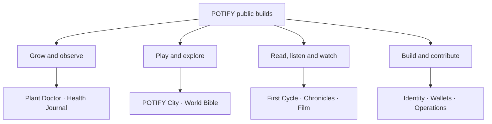

# POTIFY public builds

> **Seed → Soil → Solana.** A connected collection of growing tools, stories, games, community experiments and developer projects.

[Browse all 36 public projects by category](docs/PROJECT-INDEX.md) · [Read the field guide](docs/FIELD-GUIDE.md)

## Choose your path

| You are interested in… | Start here | What you will find |
| --- | --- | --- |
| Growing and plant health | [Plant Doctor](https://github.com/jonathanbabec5-hash/potify-plant-doctor) · [Plant Health Journal](https://github.com/jonathanbabec5-hash/potify-plant-health) | Diagnostic rules and a local observation journal |
| A life-sim world | [POTIFY City game](https://github.com/jonathanbabec5-hash/Potify) · [World Bible](https://github.com/jonathanbabec5-hash/potify-city-canon) | A playable baseline and a separate design registry |
| Stories, music and film | [The First Cycle](https://github.com/jonathanbabec5-hash/potify-first-cycle-public-edition) · [Chronicles](https://github.com/jonathanbabec5-hash/potify-chronicles) · [From Seed to Smoke](https://github.com/jonathanbabec5-hash/potify-seed-to-smoke) | A public reading and listening edition and film preview |
| Community and identity | [Greenhouse](https://github.com/jonathanbabec5-hash/potify-holder-hub) · [Potify ID](https://github.com/jonathanbabec5-hash/potify-id) | A local community beta and a separate identity pilot |
| Wallets and payments | [Project Reclaim](https://github.com/jonathanbabec5-hash/potify-reclaim-developer) · [Green Light Pay](https://github.com/jonathanbabec5-hash/potify-green-light-pay) | Wallet recovery source and a payment simulation |
| Agents and Solana | [Roots Agent Gateway](https://github.com/jonathanbabec5-hash/potify-roots-agent-gateway) · [TukTuk observer](https://github.com/jonathanbabec5-hash/potify-tuktuk-worker) | A read-only wallet preview and a job-payout observer |
| Publishing and operations | [Operations Workflow](https://github.com/jonathanbabec5-hash/potify-operations-workflow) · [Dispatch Console](https://github.com/jonathanbabec5-hash/potify-dispatch-console-reference) | Review-state logic and a local reference app |

These are **discovery paths**, not claims that the projects are integrated or deployed together. Each project explains its own evidence and limitations. [Browse the full field guide](docs/FIELD-GUIDE.md) for the wider collection.

### How the collection fits together



[How we chose these navigation patterns](docs/GITHUB-PRESENTATION-GUIDE.md)

[Full repository tree](docs/DIRECTORY.md) · [Portfolio whitepaper](docs/WHITEPAPER.md) · [Marketing and sales plan](docs/MARKETING.md) · [Build log](docs/BUILD-LOG.md)

## Find a project worth your next five minutes

A yellow leaf, a pencilled name on a seed packet, a rooftop lease: these are small enough that a stranger can look closely and see something the builder missed. That is the invitation behind Seed → Soil → Solana. You don’t need a wallet or a pitch. Pick a question you care about and bring back one detail somebody else can check.

| If you came for… | Start here | A useful first contribution |
| --- | --- | --- |
| Growing | [Plant Doctor](https://github.com/jonathanbabec5-hash/potify-plant-doctor/blob/63488a0679ccf250bb6dc1ed6ed9f209e3ba8e28/src/diagnosis.ts) | Change moisture in one fictional case. Did the first suggested check change? |
| A world to play in | [Roof 7B’s resident tasks](https://github.com/jonathanbabec5-hash/Potify/blob/1cfb7051dd15b886a25062e6b6831466cbaf3c9b/artifacts/potify-high-life/src/game/story.ts) | Follow a harvest into the lease story and name the first unclear step. |
| A book, a song, a film | [Open the free edition](https://potify-first-cycle.wile-e-coyot.chatgpt.site/#edition) | Find Book I of The POTIFY Chronicle, listen to *The Soil Remembers (Grow Room Version)* and see if you can return to your passage. The From Seed to Smoke premiere NFT has its own [eligibility and status page](https://potify-first-cycle.wile-e-coyot.chatgpt.site/premiere/). |
| How wallet estimates are explained | [Project Reclaim’s integer example](https://github.com/jonathanbabec5-hash/potify-reclaim-developer/blob/1de4db4fe232a2e7c6074c1c079509c33fb95fa3/src/quote.mjs) | Work out the net on paper before looking at the answer. No wallet required. |
| Editorial tools | [Operations Workflow](https://github.com/jonathanbabec5-hash/potify-operations-workflow/blob/6ae977c5b6ffaaa8922cf48cfd2d0e98285a5ba0/lib/workflow.ts) | Change a word in an approved fixture and see what evidence the new version needs. |

[Read the field guide to all 36 projects](docs/FIELD-GUIDE.md) · [Get the public data and source map](data/field-guide-sources.json) · [Follow the builder on GitHub](https://github.com/jonathanbabec5-hash) for the next documented change. For a correction, name the project, revision, expected result and what you observed. Keep personal and production data out of public reports.

## More development branches and original work

- **POTIFY City · A Wonderful High Life.** The November 4 teaser starts with one rooftop. The November 8 campaign draft asks what the first harvest should pay for, a bigger greenhouse or a delivery operation. Explore the original images, caption, and public game bible together. [Original marketing and design archive](https://github.com/jonathanbabec5-hash/Potify/blob/37f99867c04c8d13197def4dd964e23a661ef606/docs/marketing/ORIGINALS.md) · [Checksums for the 13 original files](https://github.com/jonathanbabec5-hash/Potify/blob/37f99867c04c8d13197def4dd964e23a661ef606/docs/marketing/SHA256SUMS)
- **POTIFY Roots Agent Gateway.** This companion to Project Reclaim exposes a read-only wallet preview for agents over HTTP and MCP. Its launch plan proposes five independent tool calls before a paid pilot. The standalone edition includes the scanner and runs with a single install. Seven offline tests passed and payments default to disabled. [Standalone source, tests and launch plan](https://github.com/jonathanbabec5-hash/potify-roots-agent-gateway/tree/bd58b74a4d3778964a824555349609f85def79a0) · [Original integration](https://github.com/jonathanbabec5-hash/potify-reclaim-developer/tree/c73d2688451bfe5f8010865a6712e5d6050e7d72/agent-gateway)

- **POTIFY TukTuk worker.** Replay finalized job payouts and check how much the winner retained after fees. This observer includes the raw examples, tests, technical paper and a proposed queue-owner reporting pilot. The recorded payouts went to other workers. [Standalone observer and project plans](https://github.com/jonathanbabec5-hash/potify-tuktuk-worker/tree/30c986d5625b3b38f76eea63a212983987b3b587) · [Portfolio integration](https://github.com/jonathanbabec5-hash/potify-public-builds/pull/2)

## Project directory

[Browse the grouped index with current repository links](docs/PROJECT-INDEX.md). The table below records specific documentation releases; its commit-pinned links may predate current default branches.


The 36 entries cover applications, modules, creative editions, reference tools and specifications. Select **Paper** for the engineering or editorial decisions and **Plan** for the audience, proposed offer and sales measurement. The first targets are proposed. The public Command Center entry is a specification; the original workspace identifies a separate creator, whose permission to distribute it is still outstanding.

| Project and verified documentation release | Available scope | Proposed first target | Project documents |
| --- | --- | --- | --- |
| [Plant Doctor](https://github.com/jonathanbabec5-hash/potify-plant-doctor/tree/38bf32339efb320e6145d7ea2023334dea147ccc) | Original Replit diagnostic app, standalone rule engine and website condition library | 5 actionable fixture reviews | [Paper](https://github.com/jonathanbabec5-hash/potify-plant-doctor/blob/38bf32339efb320e6145d7ea2023334dea147ccc/docs/WHITEPAPER.md) · [Plan](https://github.com/jonathanbabec5-hash/potify-plant-doctor/blob/38bf32339efb320e6145d7ea2023334dea147ccc/docs/MARKETING.md) · [Tree](https://github.com/jonathanbabec5-hash/potify-plant-doctor/blob/38bf32339efb320e6145d7ea2023334dea147ccc/docs/DIRECTORY.md) |
| [POTIFY City · Roof 7B](https://github.com/jonathanbabec5-hash/Potify/tree/ddb72dda85527bf41b5fd4826adf22afadc6f8a4) | Existing GitHub game and tested developer update | 5 observed first harvests and 3 field-guide opt-ins | [Paper](https://github.com/jonathanbabec5-hash/Potify/blob/ddb72dda85527bf41b5fd4826adf22afadc6f8a4/docs/WHITEPAPER.md) · [Plan](https://github.com/jonathanbabec5-hash/Potify/blob/ddb72dda85527bf41b5fd4826adf22afadc6f8a4/docs/MARKETING.md) · [Tree](https://github.com/jonathanbabec5-hash/Potify/blob/ddb72dda85527bf41b5fd4826adf22afadc6f8a4/docs/DIRECTORY.md) |
| [The First Cycle Edition](https://github.com/jonathanbabec5-hash/potify-first-cycle-public-edition/tree/dcd4dc2e2526ce3f5341f0b9b81926be99244f3c) | Public edition frontend | 20 qualified edition opens | [Paper](https://github.com/jonathanbabec5-hash/potify-first-cycle-public-edition/blob/dcd4dc2e2526ce3f5341f0b9b81926be99244f3c/docs/WHITEPAPER.md) · [Plan](https://github.com/jonathanbabec5-hash/potify-first-cycle-public-edition/blob/dcd4dc2e2526ce3f5341f0b9b81926be99244f3c/docs/MARKETING.md) · [Tree](https://github.com/jonathanbabec5-hash/potify-first-cycle-public-edition/blob/dcd4dc2e2526ce3f5341f0b9b81926be99244f3c/docs/DIRECTORY.md) |
| [Potify ID](https://github.com/jonathanbabec5-hash/potify-id/tree/4fedbe688793f93e3437eaf83a8626096b2c633e) | Two-app pilot and website integration source | 2 external developers reproduce the fixture | [Paper](https://github.com/jonathanbabec5-hash/potify-id/blob/4fedbe688793f93e3437eaf83a8626096b2c633e/docs/WHITEPAPER.md) · [Plan](https://github.com/jonathanbabec5-hash/potify-id/blob/4fedbe688793f93e3437eaf83a8626096b2c633e/docs/MARKETING.md) · [Tree](https://github.com/jonathanbabec5-hash/potify-id/blob/4fedbe688793f93e3437eaf83a8626096b2c633e/docs/DIRECTORY.md) |
| [Green Light Pay Consumer](https://github.com/jonathanbabec5-hash/potify-green-light-pay/tree/f5ba48170c77fcad78dbc739f354cd33228fbac6) | Working sandbox and reference source | 5 merchant walkthrough completions | [Paper](https://github.com/jonathanbabec5-hash/potify-green-light-pay/blob/f5ba48170c77fcad78dbc739f354cd33228fbac6/docs/WHITEPAPER.md) · [Plan](https://github.com/jonathanbabec5-hash/potify-green-light-pay/blob/f5ba48170c77fcad78dbc739f354cd33228fbac6/docs/MARKETING.md) · [Tree](https://github.com/jonathanbabec5-hash/potify-green-light-pay/blob/f5ba48170c77fcad78dbc739f354cd33228fbac6/docs/DIRECTORY.md) |
| [Project Reclaim](https://github.com/jonathanbabec5-hash/potify-reclaim-developer/tree/8a0f350a5955b140ec98afc6163a84088c48ffae) | Original wallet engine and verification source | 5 users correctly identify fee and net | [Paper](https://github.com/jonathanbabec5-hash/potify-reclaim-developer/blob/8a0f350a5955b140ec98afc6163a84088c48ffae/docs/WHITEPAPER.md) · [Plan](https://github.com/jonathanbabec5-hash/potify-reclaim-developer/blob/8a0f350a5955b140ec98afc6163a84088c48ffae/docs/MARKETING.md) · [Tree](https://github.com/jonathanbabec5-hash/potify-reclaim-developer/blob/8a0f350a5955b140ec98afc6163a84088c48ffae/docs/DIRECTORY.md) |
| [Vape God](https://github.com/jonathanbabec5-hash/potify-vape-god/tree/d3e572c196751da0d9e17d8dcbd7ccb1d45913b1) | Editable original game client | 10 distinct completed rounds | [Paper](https://github.com/jonathanbabec5-hash/potify-vape-god/blob/d3e572c196751da0d9e17d8dcbd7ccb1d45913b1/docs/WHITEPAPER.md) · [Plan](https://github.com/jonathanbabec5-hash/potify-vape-god/blob/d3e572c196751da0d9e17d8dcbd7ccb1d45913b1/docs/MARKETING.md) · [Tree](https://github.com/jonathanbabec5-hash/potify-vape-god/blob/d3e572c196751da0d9e17d8dcbd7ccb1d45913b1/docs/DIRECTORY.md) |
| [POTIFY Merch Directory](https://github.com/jonathanbabec5-hash/potify-merch/tree/d294239749a596aa7f8aa602498408064f50cb64) | Store integration reference | 10 qualified product views | [Paper](https://github.com/jonathanbabec5-hash/potify-merch/blob/d294239749a596aa7f8aa602498408064f50cb64/docs/WHITEPAPER.md) · [Plan](https://github.com/jonathanbabec5-hash/potify-merch/blob/d294239749a596aa7f8aa602498408064f50cb64/docs/MARKETING.md) · [Tree](https://github.com/jonathanbabec5-hash/potify-merch/blob/d294239749a596aa7f8aa602498408064f50cb64/docs/DIRECTORY.md) |
| [POTIFY Dispatch Console](https://github.com/jonathanbabec5-hash/potify-dispatch-console-reference/tree/01ba3eb504f49184e3ee3289ed6a79287479f832) | Local reference app | 5 completed local rehearsals | [Paper](https://github.com/jonathanbabec5-hash/potify-dispatch-console-reference/blob/01ba3eb504f49184e3ee3289ed6a79287479f832/docs/WHITEPAPER.md) · [Plan](https://github.com/jonathanbabec5-hash/potify-dispatch-console-reference/blob/01ba3eb504f49184e3ee3289ed6a79287479f832/docs/MARKETING.md) · [Tree](https://github.com/jonathanbabec5-hash/potify-dispatch-console-reference/blob/01ba3eb504f49184e3ee3289ed6a79287479f832/docs/DIRECTORY.md) |
| [POTIFY Operations Workflow](https://github.com/jonathanbabec5-hash/potify-operations-workflow/tree/a8a31f167edd9d52e5159135a9ca98269b48d2e9) | Public approval-state library | 3 editorial teams run the examples | [Paper](https://github.com/jonathanbabec5-hash/potify-operations-workflow/blob/a8a31f167edd9d52e5159135a9ca98269b48d2e9/docs/WHITEPAPER.md) · [Plan](https://github.com/jonathanbabec5-hash/potify-operations-workflow/blob/a8a31f167edd9d52e5159135a9ca98269b48d2e9/docs/MARKETING.md) · [Tree](https://github.com/jonathanbabec5-hash/potify-operations-workflow/blob/a8a31f167edd9d52e5159135a9ca98269b48d2e9/docs/DIRECTORY.md) |
| [POTIFY Telegram Editorial Kit](https://github.com/jonathanbabec5-hash/potify-telegram-editorial/tree/456d44b03ca6d55e1dc6adcfedfae9434133d279) | Recovered bot source and offline review tool | 5 successful duplicate-draft reviews | [Paper](https://github.com/jonathanbabec5-hash/potify-telegram-editorial/blob/456d44b03ca6d55e1dc6adcfedfae9434133d279/docs/WHITEPAPER.md) · [Plan](https://github.com/jonathanbabec5-hash/potify-telegram-editorial/blob/456d44b03ca6d55e1dc6adcfedfae9434133d279/docs/MARKETING.md) · [Tree](https://github.com/jonathanbabec5-hash/potify-telegram-editorial/blob/456d44b03ca6d55e1dc6adcfedfae9434133d279/docs/DIRECTORY.md) |
| [Potify Command Center](https://github.com/jonathanbabec5-hash/potify-command-center-handoff/tree/441f7dff6445520399cbb53c0924d23cf3579b14) | Public handoff specification for a workspace created by a separate maintainer | 1 verified source handoff | [Paper](https://github.com/jonathanbabec5-hash/potify-command-center-handoff/blob/441f7dff6445520399cbb53c0924d23cf3579b14/docs/WHITEPAPER.md) · [Plan](https://github.com/jonathanbabec5-hash/potify-command-center-handoff/blob/441f7dff6445520399cbb53c0924d23cf3579b14/docs/MARKETING.md) · [Tree](https://github.com/jonathanbabec5-hash/potify-command-center-handoff/blob/441f7dff6445520399cbb53c0924d23cf3579b14/docs/DIRECTORY.md) |
| [The Living Archive](https://github.com/jonathanbabec5-hash/potify-living-archive/tree/1a99debe387dea2c53f97f201af4221cd8348497) | Technical source reference; the Living Archive remains private. | Owner review of access and campaign wording; no public readership target. | [Paper](https://github.com/jonathanbabec5-hash/potify-living-archive/blob/1a99debe387dea2c53f97f201af4221cd8348497/docs/WHITEPAPER.md) · [Plan](https://github.com/jonathanbabec5-hash/potify-living-archive/blob/1a99debe387dea2c53f97f201af4221cd8348497/docs/MARKETING.md) · [Tree](https://github.com/jonathanbabec5-hash/potify-living-archive/blob/1a99debe387dea2c53f97f201af4221cd8348497/docs/DIRECTORY.md) |
| [Beneath the Surface · Launch Room](https://github.com/jonathanbabec5-hash/potify-launch-room-developer/tree/bea047cde506cdbcf928da841a9a640cf3c55604) | Public navigation component edition | 10 qualified handoffs | [Paper](https://github.com/jonathanbabec5-hash/potify-launch-room-developer/blob/bea047cde506cdbcf928da841a9a640cf3c55604/docs/WHITEPAPER.md) · [Plan](https://github.com/jonathanbabec5-hash/potify-launch-room-developer/blob/bea047cde506cdbcf928da841a9a640cf3c55604/docs/MARKETING.md) · [Tree](https://github.com/jonathanbabec5-hash/potify-launch-room-developer/blob/bea047cde506cdbcf928da841a9a640cf3c55604/docs/DIRECTORY.md) |
| [Field Card Delivery and Measurement](https://github.com/jonathanbabec5-hash/potify-field-measurement/tree/49513d5beff8f844ab8b02b840bb8cfb30688a61) | Worker source and SQL fixtures | 3 independent test runs | [Paper](https://github.com/jonathanbabec5-hash/potify-field-measurement/blob/49513d5beff8f844ab8b02b840bb8cfb30688a61/docs/WHITEPAPER.md) · [Plan](https://github.com/jonathanbabec5-hash/potify-field-measurement/blob/49513d5beff8f844ab8b02b840bb8cfb30688a61/docs/MARKETING.md) · [Tree](https://github.com/jonathanbabec5-hash/potify-field-measurement/blob/49513d5beff8f844ab8b02b840bb8cfb30688a61/docs/DIRECTORY.md) |
| [POTIFY City Public World Bible](https://github.com/jonathanbabec5-hash/potify-city-canon/tree/4b6480595d6099b529c2b8ad2a0b5ad630b5e8f3) | Creative registry and searchable site | 5 specific worldbuilding responses | [Paper](https://github.com/jonathanbabec5-hash/potify-city-canon/blob/4b6480595d6099b529c2b8ad2a0b5ad630b5e8f3/docs/WHITEPAPER.md) · [Plan](https://github.com/jonathanbabec5-hash/potify-city-canon/blob/4b6480595d6099b529c2b8ad2a0b5ad630b5e8f3/docs/MARKETING.md) · [Tree](https://github.com/jonathanbabec5-hash/potify-city-canon/blob/4b6480595d6099b529c2b8ad2a0b5ad630b5e8f3/docs/DIRECTORY.md) |
| [Plant Health Journal](https://github.com/jonathanbabec5-hash/potify-plant-health/tree/1a8c5f8729f77f66087dff7bb8f94c9b2ad21862) | Application source | 8 completed sample entries | [Paper](https://github.com/jonathanbabec5-hash/potify-plant-health/blob/1a8c5f8729f77f66087dff7bb8f94c9b2ad21862/docs/WHITEPAPER.md) · [Plan](https://github.com/jonathanbabec5-hash/potify-plant-health/blob/1a8c5f8729f77f66087dff7bb8f94c9b2ad21862/docs/MARKETING.md) · [Tree](https://github.com/jonathanbabec5-hash/potify-plant-health/blob/1a8c5f8729f77f66087dff7bb8f94c9b2ad21862/docs/DIRECTORY.md) |
| [Soil Biology Weekly](https://github.com/jonathanbabec5-hash/potify-soil-biology-weekly/tree/e99e005ec4249df05f329c06649d1281f0734994) | Editorial research kit | 5 grounded reader questions in four issues | [Paper](https://github.com/jonathanbabec5-hash/potify-soil-biology-weekly/blob/e99e005ec4249df05f329c06649d1281f0734994/docs/WHITEPAPER.md) · [Plan](https://github.com/jonathanbabec5-hash/potify-soil-biology-weekly/blob/e99e005ec4249df05f329c06649d1281f0734994/docs/MARKETING.md) · [Tree](https://github.com/jonathanbabec5-hash/potify-soil-biology-weekly/blob/e99e005ec4249df05f329c06649d1281f0734994/docs/DIRECTORY.md) |
| [POTIFY Greenhouse and Holder Hub](https://github.com/jonathanbabec5-hash/potify-holder-hub/tree/6b2d42eee02f3fb2e3e84130254e74e1e8ab6dee) | Application source, local beta | 5 completed sample quests | [Paper](https://github.com/jonathanbabec5-hash/potify-holder-hub/blob/6b2d42eee02f3fb2e3e84130254e74e1e8ab6dee/docs/WHITEPAPER.md) · [Plan](https://github.com/jonathanbabec5-hash/potify-holder-hub/blob/6b2d42eee02f3fb2e3e84130254e74e1e8ab6dee/docs/MARKETING.md) · [Tree](https://github.com/jonathanbabec5-hash/potify-holder-hub/blob/6b2d42eee02f3fb2e3e84130254e74e1e8ab6dee/docs/DIRECTORY.md) |
| [Spin to Win and Prize Verification](https://github.com/jonathanbabec5-hash/potify-spin-to-win-guide/tree/5abb202bff68fc76b077b6ba80189f4d10a468a4) | Original promotion source and public route guide | 2 event organizers review the verification guide | [Paper](https://github.com/jonathanbabec5-hash/potify-spin-to-win-guide/blob/5abb202bff68fc76b077b6ba80189f4d10a468a4/docs/WHITEPAPER.md) · [Plan](https://github.com/jonathanbabec5-hash/potify-spin-to-win-guide/blob/5abb202bff68fc76b077b6ba80189f4d10a468a4/docs/MARKETING.md) · [Tree](https://github.com/jonathanbabec5-hash/potify-spin-to-win-guide/blob/5abb202bff68fc76b077b6ba80189f4d10a468a4/docs/DIRECTORY.md) |
| [POTIFY Website](https://github.com/jonathanbabec5-hash/potify-website-developer-guide/tree/d6996e5c553450c6d08de8a503c456b90ba73f5c) | Website integration source and route directory | 10 qualified project opens | [Paper](https://github.com/jonathanbabec5-hash/potify-website-developer-guide/blob/d6996e5c553450c6d08de8a503c456b90ba73f5c/docs/WHITEPAPER.md) · [Plan](https://github.com/jonathanbabec5-hash/potify-website-developer-guide/blob/d6996e5c553450c6d08de8a503c456b90ba73f5c/docs/MARKETING.md) · [Tree](https://github.com/jonathanbabec5-hash/potify-website-developer-guide/blob/d6996e5c553450c6d08de8a503c456b90ba73f5c/docs/DIRECTORY.md) |
| [From Seed to Smoke](https://github.com/jonathanbabec5-hash/potify-seed-to-smoke/tree/58aaa0ed12de1823ccad2ac3b9ee5f246ddee523) | Film preview, captions and screening page | 15 preview completions | [Paper](https://github.com/jonathanbabec5-hash/potify-seed-to-smoke/blob/58aaa0ed12de1823ccad2ac3b9ee5f246ddee523/docs/WHITEPAPER.md) · [Plan](https://github.com/jonathanbabec5-hash/potify-seed-to-smoke/blob/58aaa0ed12de1823ccad2ac3b9ee5f246ddee523/docs/MARKETING.md) · [Tree](https://github.com/jonathanbabec5-hash/potify-seed-to-smoke/blob/58aaa0ed12de1823ccad2ac3b9ee5f246ddee523/docs/DIRECTORY.md) |
| [Grow Room Sessions](https://github.com/jonathanbabec5-hash/potify-grow-room-sessions/tree/d62949df48709d7d7b5762ee6360e30dfeca60c6) | Audio edition and listening page | 10 qualified listening starts | [Paper](https://github.com/jonathanbabec5-hash/potify-grow-room-sessions/blob/d62949df48709d7d7b5762ee6360e30dfeca60c6/docs/WHITEPAPER.md) · [Plan](https://github.com/jonathanbabec5-hash/potify-grow-room-sessions/blob/d62949df48709d7d7b5762ee6360e30dfeca60c6/docs/MARKETING.md) · [Tree](https://github.com/jonathanbabec5-hash/potify-grow-room-sessions/blob/d62949df48709d7d7b5762ee6360e30dfeca60c6/docs/DIRECTORY.md) |
| [Wake and Bake POTIFY Price Update](https://github.com/jonathanbabec5-hash/potify-wake-and-bake/tree/bd8485a332779a3ef7ba5e739134ce7f9ac4bf50) | Editorial production kit | 5 repeat viewers across two approved episodes | [Paper](https://github.com/jonathanbabec5-hash/potify-wake-and-bake/blob/bd8485a332779a3ef7ba5e739134ce7f9ac4bf50/docs/WHITEPAPER.md) · [Plan](https://github.com/jonathanbabec5-hash/potify-wake-and-bake/blob/bd8485a332779a3ef7ba5e739134ce7f9ac4bf50/docs/MARKETING.md) · [Tree](https://github.com/jonathanbabec5-hash/potify-wake-and-bake/blob/bd8485a332779a3ef7ba5e739134ce7f9ac4bf50/docs/DIRECTORY.md) |
| [Green Light Pay Initiative](https://github.com/jonathanbabec5-hash/potify-glp-initiative/tree/7249fa0452b592d4c8460c39f048a9ec06b79c72) | Public microsite source | 3 completed merchant interviews | [Paper](https://github.com/jonathanbabec5-hash/potify-glp-initiative/blob/7249fa0452b592d4c8460c39f048a9ec06b79c72/docs/WHITEPAPER.md) · [Plan](https://github.com/jonathanbabec5-hash/potify-glp-initiative/blob/7249fa0452b592d4c8460c39f048a9ec06b79c72/docs/MARKETING.md) · [Tree](https://github.com/jonathanbabec5-hash/potify-glp-initiative/blob/7249fa0452b592d4c8460c39f048a9ec06b79c72/docs/DIRECTORY.md) |
| [Green Light Pay Merchant Sandbox](https://github.com/jonathanbabec5-hash/potify-glp-merchant-sandbox/tree/005c6a6eef70f30d54f428f9f9f31ccff259a886) | Recovered full-stack merchant sandbox with fictional POS, partner and reconciliation fixtures | 3 merchant workflow corrections | [Paper](https://github.com/jonathanbabec5-hash/potify-glp-merchant-sandbox/blob/005c6a6eef70f30d54f428f9f9f31ccff259a886/docs/WHITEPAPER.md) · [Plan](https://github.com/jonathanbabec5-hash/potify-glp-merchant-sandbox/blob/005c6a6eef70f30d54f428f9f9f31ccff259a886/docs/MARKETING.md) · [Tree](https://github.com/jonathanbabec5-hash/potify-glp-merchant-sandbox/blob/005c6a6eef70f30d54f428f9f9f31ccff259a886/docs/DIRECTORY.md) |
| [Green Light Pay Wallet Connection](https://github.com/jonathanbabec5-hash/potify-glp-wallet-connect/tree/988bf266a8c9c2e92b3208329461873aaedc2989) | Application source | 3 independent successful fixture runs | [Paper](https://github.com/jonathanbabec5-hash/potify-glp-wallet-connect/blob/988bf266a8c9c2e92b3208329461873aaedc2989/docs/WHITEPAPER.md) · [Plan](https://github.com/jonathanbabec5-hash/potify-glp-wallet-connect/blob/988bf266a8c9c2e92b3208329461873aaedc2989/docs/MARKETING.md) · [Tree](https://github.com/jonathanbabec5-hash/potify-glp-wallet-connect/blob/988bf266a8c9c2e92b3208329461873aaedc2989/docs/DIRECTORY.md) |
| [Green Light Pay · July Reference Sandbox](https://github.com/jonathanbabec5-hash/potify-glp-reference-sandbox/tree/342b2eae2ab2c63f1373ac64727ef6b6cdda84fb) | Historical runnable sandbox | 3 independent local reproductions | [Paper](https://github.com/jonathanbabec5-hash/potify-glp-reference-sandbox/blob/342b2eae2ab2c63f1373ac64727ef6b6cdda84fb/docs/WHITEPAPER.md) · [Plan](https://github.com/jonathanbabec5-hash/potify-glp-reference-sandbox/blob/342b2eae2ab2c63f1373ac64727ef6b6cdda84fb/docs/MARKETING.md) · [Tree](https://github.com/jonathanbabec5-hash/potify-glp-reference-sandbox/blob/342b2eae2ab2c63f1373ac64727ef6b6cdda84fb/docs/DIRECTORY.md) |
| [Field Card 01](https://github.com/jonathanbabec5-hash/potify-field-card/tree/9c10671b57aca25838800a254bd3db90d3c1777a) | Printable publication and reading pages | 10 confirmed downloads | [Paper](https://github.com/jonathanbabec5-hash/potify-field-card/blob/9c10671b57aca25838800a254bd3db90d3c1777a/docs/WHITEPAPER.md) · [Plan](https://github.com/jonathanbabec5-hash/potify-field-card/blob/9c10671b57aca25838800a254bd3db90d3c1777a/docs/MARKETING.md) · [Tree](https://github.com/jonathanbabec5-hash/potify-field-card/blob/9c10671b57aca25838800a254bd3db90d3c1777a/docs/DIRECTORY.md) |
| [First Cycle premiere NFT design source](https://github.com/jonathanbabec5-hash/potify-premiere-herbarium/tree/cbd388b614c141b8b0c565b2ee57e77b38119a3a) | 25 individual NFT designs and collection metadata; issuance is unverified. | Support the free-edition reading and listening path; measure actual visits separately. | [Paper](https://github.com/jonathanbabec5-hash/potify-premiere-herbarium/blob/cbd388b614c141b8b0c565b2ee57e77b38119a3a/docs/WHITEPAPER.md) · [Plan](https://github.com/jonathanbabec5-hash/potify-premiere-herbarium/blob/cbd388b614c141b8b0c565b2ee57e77b38119a3a/docs/MARKETING.md) · [Tree](https://github.com/jonathanbabec5-hash/potify-premiere-herbarium/blob/cbd388b614c141b8b0c565b2ee57e77b38119a3a/docs/DIRECTORY.md) |
| [Signal Drop 001](https://github.com/jonathanbabec5-hash/potify-signal-drop/tree/e208f3d51981d1e845303559c2b68c9af7f10164) | QR component and decoding test | 5 witnessed successful scans | [Paper](https://github.com/jonathanbabec5-hash/potify-signal-drop/blob/e208f3d51981d1e845303559c2b68c9af7f10164/docs/WHITEPAPER.md) · [Plan](https://github.com/jonathanbabec5-hash/potify-signal-drop/blob/e208f3d51981d1e845303559c2b68c9af7f10164/docs/MARKETING.md) · [Tree](https://github.com/jonathanbabec5-hash/potify-signal-drop/blob/e208f3d51981d1e845303559c2b68c9af7f10164/docs/DIRECTORY.md) |
| [The POTIFY Chronicles](https://github.com/jonathanbabec5-hash/potify-chronicles/tree/e06f77aa9d333dd4d4e175bc8136f97cfb7b41ba) | Original Book I text, reader source and offline edition | 12 engaged readers | [Paper](https://github.com/jonathanbabec5-hash/potify-chronicles/blob/e06f77aa9d333dd4d4e175bc8136f97cfb7b41ba/docs/WHITEPAPER.md) · [Plan](https://github.com/jonathanbabec5-hash/potify-chronicles/blob/e06f77aa9d333dd4d4e175bc8136f97cfb7b41ba/docs/MARKETING.md) · [Tree](https://github.com/jonathanbabec5-hash/potify-chronicles/blob/e06f77aa9d333dd4d4e175bc8136f97cfb7b41ba/docs/DIRECTORY.md) |
| [POTIFY Public Treasury Record](https://github.com/jonathanbabec5-hash/potify-treasury-record/tree/9456d95e900473352072e632f954045e6b337a1d) | New public reporting specification | 3 independently reproducible checks | [Paper](https://github.com/jonathanbabec5-hash/potify-treasury-record/blob/9456d95e900473352072e632f954045e6b337a1d/docs/WHITEPAPER.md) · [Plan](https://github.com/jonathanbabec5-hash/potify-treasury-record/blob/9456d95e900473352072e632f954045e6b337a1d/docs/MARKETING.md) · [Tree](https://github.com/jonathanbabec5-hash/potify-treasury-record/blob/9456d95e900473352072e632f954045e6b337a1d/docs/DIRECTORY.md) |
| [POTIFY Roots Agent Gateway](https://github.com/jonathanbabec5-hash/potify-roots-agent-gateway/tree/d8e0e882158a8bbe2aa2cdaa56fbac5ae14a38ea) | Standalone read-only gateway with local tests and a devnet payment experiment | 5 independent tool calls, then 1 verified paid pilot | [Paper](https://github.com/jonathanbabec5-hash/potify-roots-agent-gateway/blob/d8e0e882158a8bbe2aa2cdaa56fbac5ae14a38ea/docs/WHITEPAPER.md) · [Plan](https://github.com/jonathanbabec5-hash/potify-roots-agent-gateway/blob/d8e0e882158a8bbe2aa2cdaa56fbac5ae14a38ea/docs/MARKETING.md) · [Tree](https://github.com/jonathanbabec5-hash/potify-roots-agent-gateway/blob/d8e0e882158a8bbe2aa2cdaa56fbac5ae14a38ea/docs/DIRECTORY.md) |
| [POTIFY TukTuk Worker](https://github.com/jonathanbabec5-hash/potify-tuktuk-worker/tree/a670ddd019ece562dbeb21e08ed540d0d07c44c6) | Read-only Python observer, offline samples and optional operator configuration | 3 independent replays, then 1 paid and accepted queue report | [Paper](https://github.com/jonathanbabec5-hash/potify-tuktuk-worker/blob/a670ddd019ece562dbeb21e08ed540d0d07c44c6/docs/WHITEPAPER.md) · [Plan](https://github.com/jonathanbabec5-hash/potify-tuktuk-worker/blob/a670ddd019ece562dbeb21e08ed540d0d07c44c6/docs/MARKETING.md) · [Tree](https://github.com/jonathanbabec5-hash/potify-tuktuk-worker/blob/a670ddd019ece562dbeb21e08ed540d0d07c44c6/docs/DIRECTORY.md) |
| [POTIFY Shortcut Studio](https://github.com/jonathanbabec5-hash/potify-shortcut-assistant/tree/c8a095e1e44bfb6703f9e9ccc79c000b1e81bf45) | Public developer edition of the iOS Shortcuts builder, validator and exporter | Five independent builds by day 30 and one paid two-week consultancy pilot by day 45 | [Paper](https://github.com/jonathanbabec5-hash/potify-shortcut-assistant/blob/c8a095e1e44bfb6703f9e9ccc79c000b1e81bf45/docs/WHITEPAPER.md) · [Plan](https://github.com/jonathanbabec5-hash/potify-shortcut-assistant/blob/c8a095e1e44bfb6703f9e9ccc79c000b1e81bf45/docs/PILOT-MARKETING.md) · [Tree](https://github.com/jonathanbabec5-hash/potify-shortcut-assistant/blob/c8a095e1e44bfb6703f9e9ccc79c000b1e81bf45/docs/DIRECTORY.md) |

## Run the directory checks

Local verification uses Python 3.10+ and the standard library. Remote verification also needs an authenticated GitHub CLI. It reads public metadata and compares the owner, visibility, branch, commit and tree.

```sh
git clone https://github.com/jonathanbabec5-hash/potify-public-builds.git
cd potify-public-builds
python3 -m unittest discover -s tests
python3 tools/verify.py
python3 tools/verify.py --remote
```

## Contribute

Report the project, revision, device and the steps you actually tried. Project-specific changes belong in the corresponding repository. Use an issue in this directory for an incorrect mapping, scope or missing public release. See [Updating the public directory](docs/CONTRIBUTING.md).
